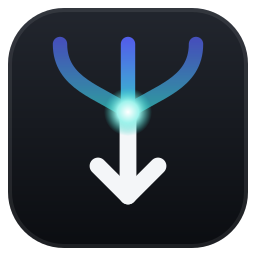
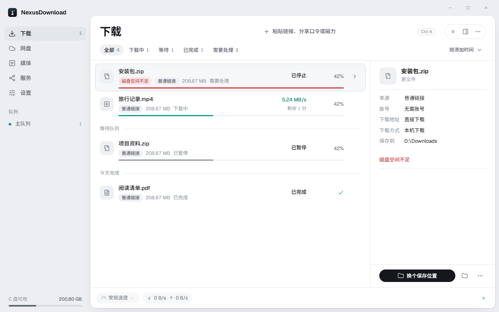
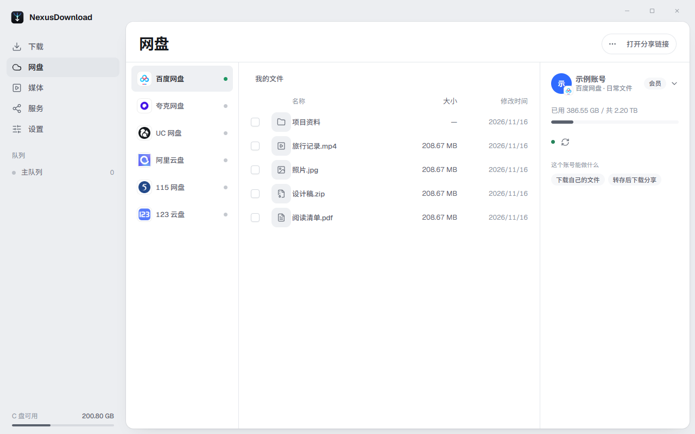
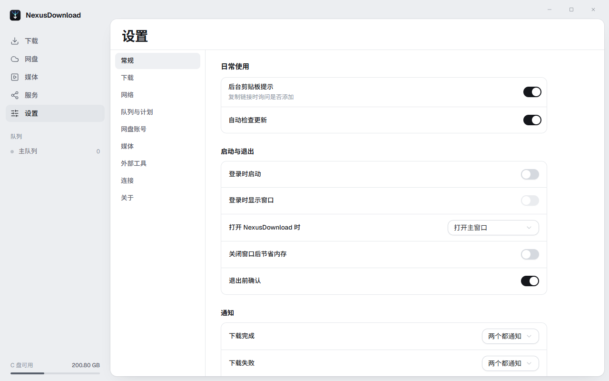

<h1 align="center">NexusDownload</h1>

A portable Windows download manager based on Motrix Turbo 2.4.1, with cloud-drive and media downloads in one place.

[简体中文](README.zh-CN.md) · [Download][releases] · [Issues][issues]

## Features

- HTTP, FTP, BitTorrent and magnet downloads with resume, queues and schedules.
- Cloud-drive accounts, shared files, video and gallery downloads.
- Optional extraction tools, phone delivery, browser integration and an AI assistant connection.
- Light and dark themes and in-app updates.

## Download and use

Download the latest `NexusDownload-vVERSION-win-x64.zip` from [Releases][releases], extract it, and open `NexusDownload.exe`. Paste a link to begin. Files use the system Downloads folder by default. Settings and account data live in the adjacent `data/` folder; keep it when moving the app. Updates are available in Settings → About.

## FAQ

- **Windows protected your PC:** builds are currently unsigned. After verifying the download source, choose “More info → Run anyway”.
- **Moved to another computer:** sign in to cloud accounts again; account storage is bound to your Windows user.
- **Aliyun Drive:** register your own application on its developer platform, set `https://www.alipan.com/o/oauth/callback` as the redirect URI, then enter the application ID and secret under Settings → Cloud accounts. See the [Chinese instructions](README.zh-CN.md#常见问题). Never post a secret in an issue.

## Acknowledgments

Built on [Motrix Turbo](https://github.com/agalwood/Motrix) and [Motrix](https://github.com/agalwood/Motrix), with implementation references from YunX and OpenList. See [third-party notices](THIRD_PARTY_NOTICES.md).

## License

[AGPL-3.0-only](LICENSE). Upstream and third-party copyright notices are retained.

## Disclaimer

1. NexusDownload is free, open-source software for personal learning. Download only content you are authorized to access.
2. Cloud drives use each platform’s web sign-in. NexusDownload is unaffiliated with these platforms, and changes may interrupt access. Frequent use may trigger restrictions; you accept all account risks.
3. The software collects no personal data. Account information stays on this computer.
4. Follow local laws and each platform’s terms. You are responsible for all consequences of using this software.
5. Send questions and suggestions to [GitHub Issues](https://github.com/NexusToolBox/NexusDownload/issues).

<!-- repository-links:start -->
[releases]: https://github.com/NexusToolBox/NexusDownload/releases
[issues]: https://github.com/NexusToolBox/NexusDownload/issues
<!-- repository-links:end -->
