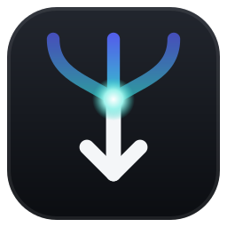
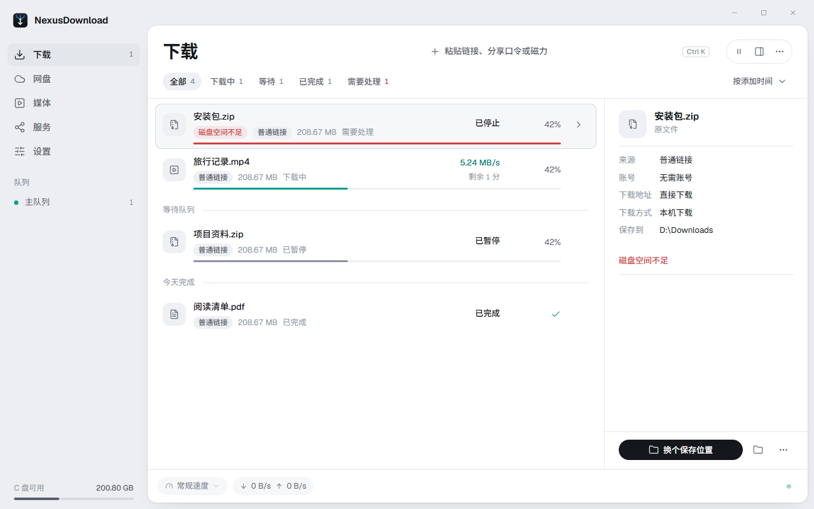
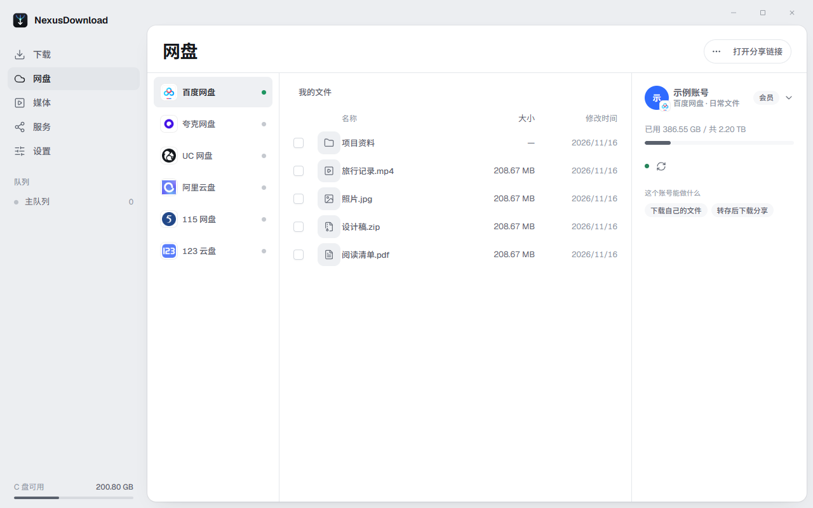
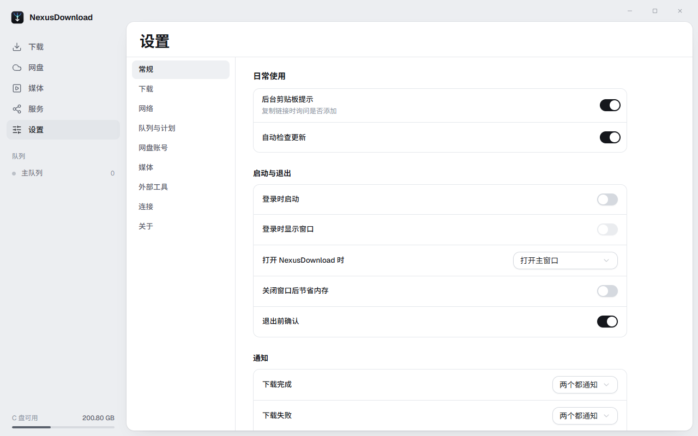

<h1 align="center">NexusDownload</h1>

基于 Motrix Turbo 2.4.1 的 Windows 便携下载工具，统一管理普通链接、网盘和媒体下载。

[官网](https://nexusdl.papicure.de/) · [English](README.md) · [下载][releases] · [反馈问题][issues]

## 主要功能

- HTTP、FTP、磁力和 BitTorrent 下载，支持断点续传与任务队列。
- 百度网盘、夸克、UC、阿里云盘、115 和 123 网盘账号与分享下载。
- 视频、图集下载，以及可选的解压和动态照片处理。
- 分类保存、计划任务、手机投递、浏览器连接和 AI 助手。
- 浅色与深色界面，软件内检查更新。

## 下载与使用

从 [Releases][releases] 下载最新的 `NexusDownload-v版本号-win-x64.zip`，解压后运行 `NexusDownload.exe`，粘贴链接即可下载。默认保存到系统的“下载”文件夹。

设置、账号及任务数据位于程序旁的 `data/` 文件夹。移动软件时请一起移动此文件夹。关于页可下载更新并重启完成替换；更新保留 `data/`。外部工具按需安装。

## 常见问题

**Windows 提示“已保护你的电脑”？** 当前版本尚未数字签名。确认从项目发布页下载后，选择“更多信息 → 仍要运行”。

**换电脑后网盘不可用？** 账号数据受 Windows 用户保护，在新电脑或新用户下需要重新登录。

**阿里云盘如何配置？** 在阿里云盘开放平台申请自己的开发者应用，将回调地址设为 `https://www.alipan.com/o/oauth/callback`。打开“设置 → 网盘账号 → 阿里云盘”，按三个步骤填写应用 ID 和应用密钥，再完成登录。不要把密钥发到反馈区。应用是否可用取决于平台审核和授权范围。

**如何反馈问题？** 在“设置 → 关于 → 导出诊断记录”后到 [Issues][issues] 提交问题。诊断导出仅保留已定义的状态、计数和检查结果，不包含账号信息；截图前请自行遮挡文件名等私人内容。

## 致谢

基于 [Motrix Turbo](https://github.com/agalwood/Motrix) 与 [Motrix](https://github.com/agalwood/Motrix) 开发，网盘和媒体实现参考了 YunX、OpenList 等项目。第三方组件、平台图标及其许可见 [第三方声明](THIRD_PARTY_NOTICES.zh-CN.md)。

## 许可证

[AGPL-3.0-only](LICENSE)。上游及第三方版权声明随源代码与发布包保留。

## 声明

1. NexusDownload 是免费开源软件，仅供个人学习，只用于下载你有权获取的内容。
2. 网盘功能通过各平台的网页登录实现，与平台无合作关系，可能随平台调整失效；频繁使用可能触发平台限制，账号风险由你自行承担。
3. 软件不收集任何个人数据，账号信息只保存在这台电脑上。
4. 请遵守所在地法律和各平台用户协议。因使用本软件产生的一切后果由使用者自行承担。
5. 问题和建议请到 [GitHub Issues](https://github.com/NexusToolBox/NexusDownload/issues) 反馈。

<!-- repository-links:start -->
[releases]: https://github.com/NexusToolBox/NexusDownload/releases
[issues]: https://github.com/NexusToolBox/NexusDownload/issues
<!-- repository-links:end -->
